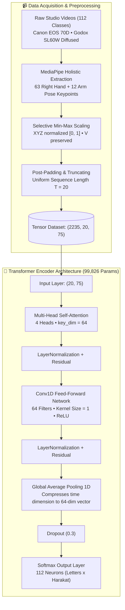

# Hijaiyah Sign Language Deep Learning Recognition (LPMQ Standard)

<div align="center">


[](https://colab.research.google.com/drive/1EqHWbovCn-lnD4LRET4GSBMm_w4u4ch4)

<p align="center">
  <strong>Comparative Performance Analysis of Bi-LSTM, Hybrid Stacked LSTM-GRU, and Transformer Encoder for LPMQ Standard Quranic Sign Language</strong><br />
  <em>Undergraduate Thesis Research • Universitas Islam Negeri Syarif Hidayatullah Jakarta • Collaborative with Lajnah Pentashihan Mushaf Al-Qur'an (LPMQ) Kementerian Agama RI</em>
</p>

</div>

---

## 📌 Executive Summary

Limited accessibility to Quranic literacy for individuals with hearing and speech sensory disabilities (**Teman Tuli**) remains a significant barrier in religious education. Official educational media currently relies on static illustrations without automated gesture validation.

This research develops an automated sequence-based gesture classification system for **112 classes of Hijaiyah letters and harakat** based on the official guidelines of **Lajnah Pentashihan Mushaf Al-Qur'an (LPMQ) Kementerian Agama RI**. Utilizing **MediaPipe Holistic** to extract 75 coordinate keypoints (hand and arm pose), this study benchmarks three sequence deep learning architectures:
1. **Bi-Directional LSTM (Bi-LSTM)** — *Baseline 1*
2. **Hybrid Stacked LSTM-GRU** — *Baseline 2*
3. **Transformer Encoder (Multi-Head Self-Attention)** — *Proposed Architecture*

Experimental results confirm that the **Transformer Encoder** substantially outperforms recurrent baselines, achieving **97.54% Accuracy** and **97.51% F1-Score** on the 70:30 split scenario, establishing a new state-of-the-art benchmark for dynamic Quranic sign recognition.

---

## 📊 Experimental Benchmark & Results

Evaluated on an unseen test set with **Weighted Average** metrics across all 112 classes (Ref: *Skripsi Chapter V, Table 5.9*):

| Model Architecture | Scenario Split (Train:Test) | Accuracy | Precision | Recall | F1-Score | Status |
| :--- | :---: | :---: | :---: | :---: | :---: | :---: |
| **Transformer Encoder** | **70:30** | **97.54%** | **98.00%** | **97.54%** | **97.51%** | 🏆 **Best (SOTA)** |
| **Transformer Encoder** | 80:20 | 94.41% | 95.54% | 94.41% | 94.38% | High Generalization |
| **Bi-LSTM** | 70:30 | 83.22% | 86.54% | 83.22% | 82.98% | Baseline 1 |
| **Bi-LSTM** | 80:20 | 70.02% | 73.79% | 70.02% | 69.10% | Moderate Stability |
| **Hybrid LSTM-GRU** | 70:30 | 69.13% | 70.10% | 69.13% | 67.05% | Baseline 2 |
| **Hybrid LSTM-GRU** | 80:20 | 60.85% | 64.79% | 60.85% | 59.00% | High Gradient Noise |

### 🔬 Key Computational Findings
- **Why Transformer Outperformed RNNs**: Recurrent architectures (Bi-LSTM & Hybrid) suffer from *information bottleneck* when compressing 20 frames into a final hidden state, leading to ambiguity on fine-grained finger movements. The Transformer Encoder leverages **Multi-Head Self-Attention (4 parallel heads)** to compute pairwise frame dependencies globally, preserving spatial subtleties throughout the sequence.
- **Data Efficiency**: Even when training data was reduced to 70%, the Transformer Encoder maintained a negligible train-validation gap (< 3%), proving superior resistance to overfitting on pose-coordinate sequences.

---

## 📐 System Pipeline & Architecture



---

## 📁 Repository Structure

```text
hijaiyah-sign-language-recognition/
├── notebooks/
│   └── hijaiyah_recognition_colab.ipynb  # Interactive Google Colab notebook
│
├── src/
│   ├── __init__.py
│   ├── feature_extraction.py             # 75-keypoints MediaPipe Holistic extractor
│   ├── preprocessing.py                  # Min-Max normalizer, post-padding, stratified splitter
│   ├── models/
│   │   ├── __init__.py
│   │   ├── transformer_encoder.py        # Proposed SOTA Transformer architecture
│   │   ├── bilstm.py                     # Baseline 1 Bi-LSTM architecture
│   │   └── hybrid_lstm_gru.py            # Baseline 2 Stacked LSTM-GRU architecture
│   ├── train.py                          # Training pipeline CLI with EarlyStopping & Checkpoints
│   ├── evaluate.py                       # Evaluator calculating weighted metrics & confusion matrix
│   └── realtime_inference.py             # Real-time webcam demo with sliding window & UI overlay
│
├── data/
│   ├── sample/                           # Demonstration sample tensors (.npy)
│   └── README.md                         # Google Drive download links & dataset specs
│
├── requirements.txt                      # Project dependencies
├── .gitignore                            # Git filters for large weights and raw video files
└── README.md                             # Comprehensive research documentation
```

---

## ⚡ Quickstart & Usage

### 1. Installation
Clone the repository and install dependencies:
```bash
git clone https://github.com/zeyniaa/hijaiyah-sign-language-recognition.git
cd hijaiyah-sign-language-recognition
pip install -r requirements.txt
```

### 2. Model Training
Train any of the three architectures with configurable splits:
```bash
# Train proposed Transformer Encoder on 70:30 split
python src/train.py --model transformer --split 70:30 --epochs 200 --batch-size 32

# Train Bi-LSTM baseline on 80:20 split
python src/train.py --model bilstm --split 80:20 --epochs 200 --batch-size 32
```

### 3. Model Evaluation
Evaluate a trained model checkpoint and generate the confusion matrix:
```bash
python src/evaluate.py --model-path checkpoints/transformer_70_30_best.h5 --output-img docs/confusion_matrix.png
```

### 4. Real-Time Webcam Demo
Run live gesture classification using your laptop webcam:
```bash
python src/realtime_inference.py --model-path checkpoints/transformer_70_30_best.h5 --camera 0
```
*Press `q` in the video window to quit.*

### 5. Run in Google Colab
Click the badge below to run the complete end-to-end pipeline directly on Google Colab with free GPU:
[](https://colab.research.google.com/drive/1EqHWbovCn-lnD4LRET4GSBMm_w4u4ch4)

---

## 📖 Citation

If you find this research or code useful in your work, please cite:

```bibtex
@article{zeiniah2026hijaiyah,
  title     = {Komparasi Kinerja Bi-LSTM, Hybrid LSTM-GRU, Dan Transformer Encoder Pada Pengenalan Huruf Hijaiyah Isyarat Standar LPMQ},
  author    = {Zeiniah},
  journal   = {Skripsi Program Studi Teknik Informatika, Fakultas Sains dan Teknologi},
  publisher = {UIN Syarif Hidayatullah Jakarta},
  year      = {2026},
  address   = {Ciputat, Indonesia}
}
```

---

## 🤝 Acknowledgments
- **Lajnah Pentashihan Mushaf Al-Qur'an (LPMQ) Kementerian Agama RI** for providing access to physical guideline standards and studio facilities.
- **Majelis Taklim Tuli Indonesia (MTTI)** & **Yayasan Ibtisamah Mulia** for observational support and field insights.
- Thesis Advisors: **Khodijah Hulliyah, M.Si., Ph.D.** & **Feri Fahrianto, M.Sc., Ph.D.**

## 🖥️ Gradio Live Camera Interface

The repository includes a webcam UI that uses the same MediaPipe keypoint extraction, 20-frame sequence window, and Transformer checkpoint as the real-time inference pipeline. It does not display example predictions when the model file is absent.

```bash
pip install -r requirements.txt
# Place the trained checkpoint at checkpoints/transformer_70_30_best.h5
python app.py
```

Open the local Gradio URL, allow camera access, and perform a gesture. Reset Sequence clears the temporal window. The model checkpoint is not stored in this repository; see data/README.md for dataset and model access notes.

---
